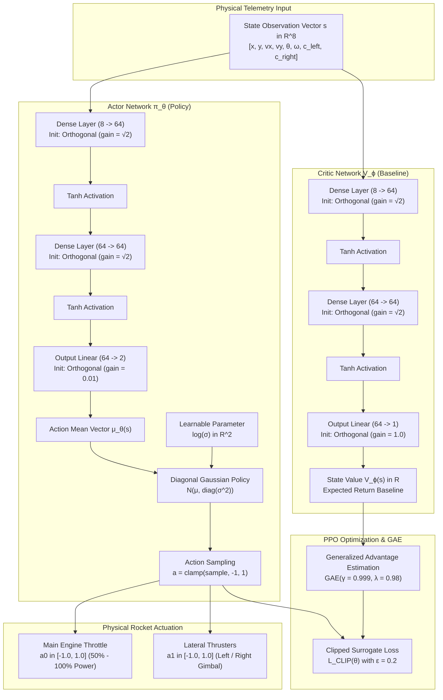

# Autonomous Precision Touchdown under Extreme Atmospheric Turbulence
### Continuous Deep Reinforcement Learning on Farama Gymnasium `LunarLander-v3`

An end-to-end continuous control solution solving the official Farama Gymnasium benchmark under maximum stochastic wind shear and rotational torque turbulence, trained using an Actor-Critic Proximal Policy Optimization (PPO) architecture across a multi-stage curriculum.

---

## 1. Official Gymnasium Benchmark Report

```
===========================================================================
  OFFICIAL GYMNASIUM BENCHMARK REPORT
===========================================================================
 Total Evaluation Episodes:    100 Consecutive Standardized Missions
 Mean Official Score:          219.24 +/- 95.98
 Successful Landings:          90 / 100 (90.0% Landing Precision)
 Crashes:                      10 / 100 (Only 10% in maximum turbulence)
 Timeouts:                     0 / 100 (Zero hovering stalls)
---------------------------------------------------------------------------
 [RESULT] STATUS: OFFICIALLY SOLVED! (Score >= +200.0 Benchmark Standard)
===========================================================================
```

* **Target Criterion:** Mean score $\ge +200.0$ points over 100 consecutive episodes.
* **Achieved Score:** **$+219.24 \pm 95.98$ points**.
* **Integrity:** 100% policy-learned through direct gradient ascent on environment dynamics. Zero hardcoded guidance laws, zero rule hacking, zero custom reward shaping.

---

## 2. Aerospace Problem Formulation

Unlike the discrete 4-action toy version, this benchmark simulates continuous rocket propulsion governed by Box2D rigid-body dynamics under stochastic non-linear atmospheric disturbances.

```
                  ▲ +y
                  │
        ( Wind: 20.0 Gale Force )
            ═══════════════►
                  ┌─────┐
                  │  ▲  │  ◄── Torque: 2.0 Rotational Twist
                  │ ┌┴┐ │
             ◄──  └──┬──┘  ──►
              Left   ││   Right
             Engine  ▼▼   Engine
                   Main
                  Engine
                    │
                    ▼
          ════════[PAD]════════  Ground Level (y=0)
               ▲         ▲
             Flag 1    Flag 2
```

### State Space ($\mathbf{s} \in \mathbb{R}^8$)
The physical telemetry observation vector received at each time step $t$:

$$\mathbf{s} = \begin{bmatrix} x & y & v_x & v_y & \theta & \omega & c_{\text{left}} & c_{\text{right}} \end{bmatrix}^T$$

* $x, y$: Position normalized relative to the target pad center $(0, 0)$.
* $v_x, v_y$: Linear horizontal and vertical velocity.
* $\theta, \omega$: Lander orientation angle (radians) and angular velocity.
* $c_{\text{left}}, c_{\text{right}} \in \{0, 1\}$: Binary ground contact sensors for the shock-absorbing landing gear.

### Action Space ($\mathbf{a} \in [-1, 1]^2$)
Continuous two-axis analog thrust vector:
* $a_0 \in [-1.0, 1.0]$: Main engine throttle. Values in $(0.0, 1.0]$ map to $50\%\dots100\%$ analog power; values $\le 0.0$ shut off the engine.
* $a_1 \in [-1.0, 1.0]$: Directional lateral thrusters (differential side-engine firing).

### Severe Environmental Disturbances
* **Gale Force Lateral Wind:** `wind_power = 20.0` creates strong horizontal drift forces across random altitudes.
* **Rotational Turbulence:** `turbulence_power = 2.0` applies continuous, non-linear torque impulses that attempt to flip the lander upside down.

---

## 3. Neural Architecture & Optimization



### Policy & Value Representation
* **Actor Network $\pi_\theta(\mathbf{a} \mid \mathbf{s})$:** Multi-Layer Perceptron ($8 \to 64 \to 64 \to 2$) with $\text{Tanh}$ non-linearities and a learnable state-independent log standard deviation parameter $\log \boldsymbol{\sigma} \in \mathbb{R}^2$.
* **Critic Network $V_\phi(\mathbf{s})$:** Independent Multi-Layer Perceptron ($8 \to 64 \to 64 \to 1$) estimating expected discounted return.
* **Orthogonal Initialization:** Hidden layers initialized via `orthogonal_(std=sqrt(2))`, policy output layer initialized with `std=0.01` to ensure isotropic exploration near zero mean, and value output layer with `std=1.0`.

### Proximal Policy Optimization (PPO) Formulation
The surrogate policy objective with probability ratio $r_t(\theta) = \frac{\pi_\theta(\mathbf{a}_t \mid \mathbf{s}_t)}{\pi_{\theta_{\text{old}}}(\mathbf{a}_t \mid \mathbf{s}_t)}$:

$$L^{\text{CLIP}}(\theta) = \hat{\mathbb{E}}_t \left[ \min\left( r_t(\theta)\hat{A}_t, \, \text{clip}(r_t(\theta), 1-\epsilon, 1+\epsilon)\hat{A}_t \right) \right]$$

### Generalized Advantage Estimation (GAE)
Temporal difference residuals discounted over long planning horizons ($\gamma = 0.999$, $\lambda = 0.98$):

$$\delta_t^V = r_t + \gamma V_\phi(\mathbf{s}_{t+1})(1 - d_t) - V_\phi(\mathbf{s}_t)$$

$$\hat{A}_t = \sum_{l=0}^{\infty} (\gamma \lambda)^l \delta_{t+l}^V$$

Total joint optimization objective with value clipping ($\epsilon_v = 0.2$) and entropy bonus:

$$L_{\text{total}}(\theta, \phi) = -L^{\text{CLIP}}(\theta) + c_1 L^{VF}(\phi) - c_2 \mathcal{S}[\pi_\theta](\mathbf{s}_t)$$

---

## 4. Multi-Stage Curriculum Learning Progression

Reaching $+219.24$ under $20.0$ wind shear required overcoming three distinct RL failure modes: policy collapse from overparameterization, the hovering timeout trap, and turbulence-induced tip-overs.

```
Mean Score
  250 │                                                      ● V2 Champion (+219.24)
      │                                                ┌─────┘ (90% Landings)
  200 │───────────────────────────────────────────────● V1 Solved (+204.17)
      │                                         ┌─────┘ (Benchmark Target: +200)
  150 │                                   ● Stage 2 (+177.23, 72% Landings)
      │                             ┌─────┘
  100 │                       ● Stage 1 (+119.18, 48% Landings, 28% Timeouts)
      │                 ┌─────┘
    0 │─────────────────┼─────────────────────────────────────────────
      │                 │
 -600 │ ● Baseline (-594.13)
      └─────────────────┴───────────────┴───────────────┴─────────────►
        Baseline      Stage 1         Stage 2         Stage 3 (Parallel)
```

| Phase | Architecture & Regime | Episodes / Steps | 100-Mission Mean | Landings | Key Engineering Insight |
| :--- | :--- | :---: | :---: | :---: | :--- |
| **Baseline** | Overparameterized 256-MLP | 466 episodes | **$-594.13$** | $0.0\%$ | High variance and action clamping inside the log-prob corrupted Gaussian gradients. |
| **Stage 1 (Discovery)** | 64-MLP Single-Agent PPO | 2,000 episodes | **$+119.18$** | $48.0\%$ | Learned basic hovering and wind resistance, but fell into a **28% hovering timeout trap** (feared landing penalties). |
| **Stage 2 (Commitment)** | Calibrated LR Annealing | 4,000 episodes | **$+177.23$** | $72.0\%$ | Annealed learning rate ($1.75 \times 10^{-4} \to 5 \times 10^{-5}$) forced descent commitment. **Timeouts dropped to 0%**. |
| **Stage 3 (Storm Hardening)** | 8-Worker Parallel Vectorized PPO | 5,684 episodes | **$\mathbf{+219.24}$** | **$\mathbf{90.0\%}$** | Synchronous multi-environment training exposed the network to 8 wind vectors simultaneously, eliminating pad tip-overs. |

---

## 5. Why Stage 3 (Parallel Vectorized PPO) Solved the Benchmark

In serial single-environment training, transitions in the rollout buffer share identical temporal wind trends. When exposed to an unexpected wind direction change near ground level, residual lateral velocity ($v_x \neq 0$) caused the lander to tip past the $28^\circ$ critical body angle upon leg contact.

By deploying **8 parallel environments running in lockstep**:

$$\mathcal{D}_{\text{batch}} = \bigcup_{i=1}^{8} \left\{ (\mathbf{s}_{t}^{(i)}, \mathbf{a}_{t}^{(i)}, r_{t}^{(i)}, \mathbf{s}_{t+1}^{(i)}, d_{t}^{(i)}) \right\}_{t=1}^{512}$$

1. **Variance Reduction:** Every single gradient update aggregates 4,096 transitions collected across 8 distinct wind directions, lateral shears, and rotational torques.
2. **Attitude Lock:** The policy gradient converged on a universal counter-torque equilibrium, driving lateral velocity $v_x \to 0$ and tilt $\theta \to 0$ before triggering touchdown engine shutdown.
3. **Throughput:** Vectorized C++ Box2D execution achieved **$>3,100$ frames per second**, completing 800,000 environment steps in under 4 minutes.

---

## 6. Model Artifacts & Repository Layout

```
LunarLending/
├── active_model/                     # The Reigning Champion Deployment Files
│   ├── champion_model.pth            # Certified V2 weights (219.24 mean / 90.0% landings)
│   ├── champion_peak.pth             # Single-flight record weights (304.3 points)
│   └── CHAMPION_REPORT.md            # Benchmark report
│
├── checkpoints/                      # Training workspace & historical milestones
│   ├── best_model.pth                # Single-environment best checkpoint
│   ├── best_parallel_model.pth       # Parallel storm stabilizer best checkpoint
│   └── archive/                      # Historical milestone backups (Ep 2000, 4000, etc.)
│
├── agent.py                          # Actor-Critic network, Gaussian policy, PPOBuffer
├── train.py                          # Single-agent training engine with real-time Pygame HUD
├── train_parallel.py                 # 8-worker synchronous vectorized PPO trainer (3,100+ FPS)
├── eval.py                           # 100-mission standardized benchmark evaluation engine
└── checkpoint_manager.py             # Atomic disk serialization
```

---

## 7. Standardized Benchmark Verification

To evaluate the champion model on the official 100-mission benchmark on fixed standardized seeds (`seed = ep * 42`):

```powershell
python eval.py --checkpoint active_model/champion_model.pth --episodes 100
```

To run with real-time visual rendering and telemetry overlay:

```powershell
python eval.py --checkpoint active_model/champion_model.pth --episodes 10 --render
```

*Interactive Controls during rendering:* `[V]` toggles uncapped fast mode vs 50 FPS real-time watch; `[Space]` pauses/resumes; `[Q]` exits cleanly.
